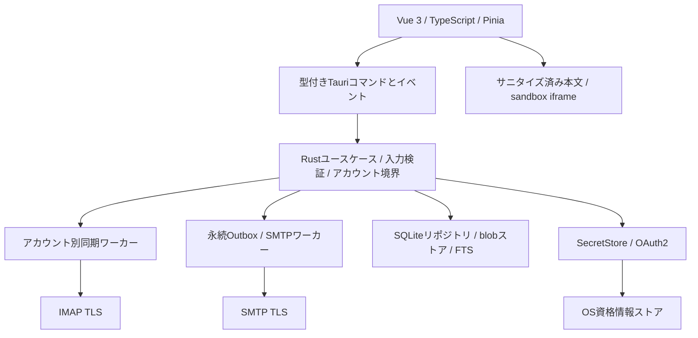

# 設計書

## 1. 製品要件と前提

- FR-01: 3OSで複数IMAPアカウントを登録し、アカウント別・統合受信箱から読む。
- FR-02: フォルダ、ページング、テキスト/HTML本文、添付一覧・保存を提供する。
- FR-03: 増分同期、再起動復旧、オフラインキャッシュ、取得状況を提供する。
- FR-04: 既読、スター、移動、ゴミ箱、明示的な完全削除を提供する。
- FR-05: SMTP送信、新規作成、返信、全員に返信、転送、添付、下書きを提供する。
- FR-06: Google / Microsoftの公開ネイティブクライアントOAuth2を提供する。
- FR-07: アカウント・フォルダ・期間・差出人・本文を組み合わせ、日本語も検索する。
- NFR-01: 秘密情報はOSの資格情報ストア、HTMLは未信頼データ、最小権限。
- NFR-02: 不明な送信結果と同期競合を利用者へ伝え、データ喪失・自動重複送信を避ける。
- NFR-03: 3OSのビルド、結合、実WebView、インストール・更新を別々に検証する。

初期サポート候補はWindows 11 x64、Ubuntu 24.04 LTS x64、macOS 14以降のarm64 / x64。これは製品の提案範囲であり、依存版・実機検証後にPhase 00で確定する。Windows ARM64、Linux ARM64、他ディストリビューションは初版対象外。OSとWebViewのセキュリティ更新が必要。

## 2. 構成と責務



Vueは画面、選択状態、入力フォーム、アクセシビリティを担当する。ネットワーク、SQL、秘密の保存、MIME解析はRustだけで行う。Pinia/localStorage/IndexedDBにメール本文・トークンを永続化しない。UIストアに必要な表示データだけを短期間保持する。

Rustはdomain → application → ports → adaptersに分割する。Tauri固有コードは薄い境界層とし、同期ロジックをTauriなしで試験可能にする。同期タスクはアカウント単位で隔離し、一方の認証失敗で他方を停止しない。SQLite書き込みは単一キュー、短いトランザクション。同期・MIME・検索の重い処理はUIスレッドで実行しない。

```text
src/                    Vue views/components/stores/services/types
src-tauri/src/          Tauri commands, app state, event wiring
crates/mail-domain/     IDs, models, errors, state machines
crates/mail-core/       use cases, sync, outbox, port traits
crates/mail-adapters/   IMAP, SMTP, OAuth, SecretStore, SQLite, MIME
migrations/             forward-only versioned schema
fixtures/               合成EML、悪意あるHTML、障害シナリオ
tests/                  integration / e2e
docs/                   ADR, threat model, status, support matrix
.github/workflows/      verify / integration / desktop / release
```

## 3. 依存ライブラリの選定

UI: Vue 3、TypeScript strict、Vite、Pinia、Vue Router、Vitest / Vue Test Utils。Rust: Tokio、serde、tracing、thiserror、rusqlite（bundled SQLite + FTS5候補）、lettre（SMTP候補）、mail-parser（MIME候補）、keyring（資格情報候補）、oauth2、rustls系TLS、HTML sanitizer候補。

IMAP候補はasync-imap等。ただし名称だけで採用しない。Phase 00でTLS、SASL XOAUTH2、UID処理、IDLEキャンセル、未対応拡張の扱い、保守状況、ライセンス、fuzz結果、3OSビルドを比較しADRに固定する。拡張対応不足を自作プロトコル実装で埋める前に基本機能へフォールバックする。SQLxを採用するならrusqliteと併用せずADRを変更する。

版番号はここで架空に固定しない。採用時の互換性を検証し、Node・Rust・package manager・Tauri CLI / JS / Rustの互換版を固定、Cargo.lockとフロントエンドlockfileをコミットする。OS固有featuresとTLSバックエンドも記録する。

## 4. IPC契約

コマンド例:

| コマンド | 主な入力 | 出力 / 制約 |
|---|---|---|
| account_add / account_test | host, port, tlsMode, username, secret入力 | 要約・エラーのみ。秘密の読み戻し不可 |
| account_list / account_remove | accountId | 秘密を含まないDTO。削除は範囲確認 |
| folder_list / message_list | accountId, folderId, cursor, limit | keyset pagination。limit上限200 |
| message_body | accountId, messageRef | 取得状態、プレーン文、サニタイズHTML、CID識別子 |
| sync_request / sync_cancel | accountId, scope | jobId。重複起動抑止 |
| message_mutate | scoped messageRefs, action, operationId | pending / applied / conflict |
| attachment_save | accountId, messageRef, partId | ネイティブ保存ダイアログ経由 |
| draft_save / send_enqueue | draftId, revision, operationId | revision / jobId。送信は確認済みスナップショット |
| search_messages | 構造化query, scope, cursor | 制限付き検索結果と索引進捗 |

すべての参照でaccountIdとDB所属を照合する。UIから任意SQL、任意パス、任意URLの取得を受けない。秘密入力は登録時に一度IPCを通るが、イベント・DTO・ログ・例外へ含めない。TS/Rust型を生成または契約試験で一致させる。UIDはu32、サイズ・DB ID等でJS安全整数範囲を超える値は文字列化する。

イベントは`sync_progress`、`account_state_changed`、`outbox_changed`等に限定し、jobId/accountId/連番/要約のみ。本文・件名・認証情報をイベントへばらまかない。UIはイベント欠落後にDBスナップショットを再取得できる。エラーはAuthRequired / TlsRejected / Offline / RateLimited / StorageFull / Conflict / Unsupported / SendUnknownに分類し、内部診断は伏字化した相関IDで追う。

## 5. 保存モデル

UIDはメールボックス内でのみ有効。Message-IDは欠落・重複するため主キーにしない。

| テーブル | 主な列と制約 |
|---|---|
| accounts | id UUID, display_name, endpoints, username, auth_kind, secret_ref, state。秘密そのものなし |
| folders | id, account_id, server_name_raw, display_name, delimiter, special_use, uidvalidity, uidnext, highest_modseq, sync_epoch。UNIQUE(account_id, server_name_raw) |
| messages | id, account_id, folder_id, uidvalidity, uid, envelope, internal_date, flags, modseq, body_state, blob_id。UNIQUE(account_id, folder_id, uidvalidity, uid) |
| mime_parts | id, message_id, part_id, media_type, safe_display_name, cid, size, blob_id |
| blobs | id random, relative_path, hash, byte_size, complete, ref_count。パスはRust生成 |
| sync_checkpoints | folder_id, epoch, committed_uid, scan_state。コミット済み範囲のみ |
| pending_operations | id UUID, account_id, target_snapshot, kind, desired_state, base_modseq, status, attempts, next_retry_at |
| drafts | id, account_id, revision, envelope, body, attachment_refs, updated_at |
| outbox | id UUID, draft_id, revision, immutable_mime_blob, message_id_header, envelope, state, attempt_id, smtp_result, sent_copy_state |
| search_documents | rowid, account_id, message_id, normalized_subject, normalized_body, addresses, normalization_version |
| message_fts | FTS5 external-content index over search_documents |
| schema_migrations | version, applied_at, checksum |

外部キーを各接続で有効化。複合FKまたはアプリ検証によりaccountとfolderの不整合を禁止する。日時はUTCと元ヘッダを保持し、UIで現地表示する。不正ヘッダの原文は未信頼として保持する。

SQLiteはWAL、busy timeout、クラッシュ耐性を考慮した同期設定（初期はFULL）を採用。WALはバックアップではない。DBはRust専用、単一アプリインスタンスでプロファイルをロックする。バックアップはSQLite backup API等で一貫性を保証し、DB単体の稼働中コピーを禁止する。

大きなEML/添付はアプリ専用ディレクトリのblobへ保存する。temp → fsync → atomic rename → DB参照を基本とし、クラッシュで残った孤立ファイルを起動時に回収する。DB内参照より先にファイルを削除しない。シンボリックリンクやパス境界を検証する。

本文・DB・FTS・添付は初版では平文キャッシュであり、OSログインや資格情報ストアだけで保存メールまで暗号化されるわけではない。FileVault / BitLocker等を推奨し、アプリデータへの最小ファイル権限を設定する。アプリ独自の保存時暗号化が製品要件ならPhase 00でSQLCipherとblob暗号化、キー回復、全OS配布ライセンスを追加設計し、出荷前の必須条件に変更する。

## 6. IMAP同期

IMAP4rev1を基本互換とし、rev2 / UIDPLUS / MOVE / CONDSTORE / QRESYNC / IDLE / SPECIAL-USEをCAPABILITYで検出する。拡張を前提にしない。フォルダ名はサーバ上の識別子を保存し、rev1のmodified UTF-7と対応時のUTF-8を区別する。

初回: 接続 → TLS → 認証 → capability確認 → LIST → EXAMINE → UIDVALIDITY保存 → UID SEARCHで対象UIDを列挙 → 最新からenvelope/flags/BODYSTRUCTUREをバッチ取得 → DBへ保存。本文は選択時にBODY.PEEKで取得し、閲覧のみでは既読にしない。初期表示は最新200件、メタデータの後続取得をバックグラウンドで続ける。件数と取得中表示を混同しない。

通常同期:

1. mailbox選択後にUIDVALIDITYを比較する。
2. 変更時は旧UID参照とpending操作を無効化・保留し、新epochで再同期する。旧UIDを新メールへ適用しない。
3. 新着はUID集合差分で取得する。UIDNEXTだけで削除・既読変更を検知しない。
4. CONDSTORE/QRESYNC対応時はmodseqを使い、非対応ではflags再取得と定期的な完全UID集合照合を行う。
5. 永続化とチェックポイント更新を同一トランザクションで確定する。未保存バッチを進捗に含めない。
6. IDLE通知は再同期のきっかけにするだけ。切断・タイムアウト後に再照合する。非対応ならジッター付きポーリング。

連番は永続参照に使わない。UID fetch途中のexpunge、空フォルダ、UID欠番、サーバ再起動に耐える。IDLE専用接続またはDONEで安全に中断する単一接続を採用し、同じ接続へ競合コマンドを書かない。初期は各account最大2接続、全体8接続、メタデータ100件/バッチを目安に調整する。

ネットワーク失敗は指数バックオフ+ジッター、最大5分。認証失敗は自動連打せず再認証待ち。サーバ制限に応じて同時実行数を下げる。キャンセル・タイムアウト・アカウント削除でワーカーを停止し、停止後の古い結果はgeneration照合で破棄する。

## 7. オフラインと変更競合

キャッシュ済み本文・添付だけを閲覧可能とし、未取得は「未ダウンロード」と表示する。「全件オフライン」は明示設定・容量確認・進捗付き別ジョブ。初期キャッシュ予算2GiB、本文は選択時、添付は明示取得。下書き・未送信メールは自動eviction対象にしない。

Phase 04以降の変更は、ローカル表示更新とpending_operations追加を同一トランザクションにする。既読・スターはtoggleではなくdesired stateを記録し、同一対象の操作を集約する。CONDSTORE利用時は条件付きSTORE、非対応では再取得して競合を検知できる範囲を説明する。

移動はMOVE対応を優先。非対応はCOPY → UIDPLUS等で結果特定 → 元の削除へ進む。結果を特定できない場合は曖昧状態にして破壊的処理を止める。他アカウントへの移動は初版非対応。UIDPLUSなしで無関係な\Deletedまで消す一般EXPUNGEを自動発行しない。ゴミ箱移動と完全削除は別操作、完全削除はオンラインで対象を再確認する。

競合方針: サーバ消失はtombstone、旧UIDVALIDITYは操作停止、フォルダ移動・削除の競合は利用者へ再選択を促す。サーバを正とするが、ローカル未送信・下書きは消さない。起動時にin_progressを再評価し、操作種別ごとの冪等性を確認して再開する。

## 8. SMTPと送信トレイ

新規作成・返信・全員返信・転送はアカウントとFrom identityを常時表示する。To/Cc/Bccを正規解析し、ヘッダ改行注入を拒否する。Bccは配送envelopeに含め、送信MIMEヘッダと送信済みコピーに漏らさない。返信はIn-Reply-To / References、全員返信は自分の既知identityを除外する。

送信操作時にdraft revision、宛先、添付、エンコード済みMIMEを固定し、確認画面の内容と一致させる。同じoperationIdの再クリックは同じoutboxレコードを返す。SMTPUTF8 / SIZE等は実際のcapabilityに従い、非対応の国際化アドレス等は明示エラー。最初はプレーンテキスト作成と安全な引用で開始する。

状態遷移:

```text
editing → queued → connecting → submitting → accepted → sent
                                  ↘ failed / unknown
accepted → sent_copy_pending → sent（送信済み保存の独立状態）
```

- SMTPがDATA完了を受理した最終成功応答を得るまではacceptedにしない。
- DATAの終端付近から応答確認前の切断、accepted記録前のプロセス停止はunknown。自動再送しない。「届いた可能性あり」を表示し、確認後の明示再送のみ許す。
- 送信前に失敗したことが確実な一時障害だけ自動再試行する。恒久エラー、認証失敗は操作を求める。
- RCPT単位の受理・拒否を保持する。初版は1宛先でも拒否されたらDATAを送らずRSETして全体を失敗扱いにし、部分配送を避ける。最終応答不明は別問題としてunknownにする。
- Message-IDとoutbox UUIDは追跡用でありSMTPのexactly-onceを保証しない。
- SMTP成功後のIMAP Sent APPEND失敗は「送信済み保存失敗」であり、メールを再送しない。サーバが自動保存するprovider profileは二重APPENDを避ける。APPEND結果不明も同様に再照合し、重複可能性を扱う。
- ローカル下書きは自動保存し、任意のサーバ下書き同期は後続機能。閉じる際はqueued/unknownを失わない。

## 9. OAuth2と秘密管理

ネイティブ公開クライアントとしてAuthorization Code + PKCE S256、state照合、外部システムブラウザを利用する。client secretを配布バイナリへ埋め込まない。loopback redirectは127.0.0.1等のloopbackだけで待ち受け、ランダムport、短い期限、1回限りのcallback、登録済みredirect条件を検証する。プロバイダが認める形式を採用する。埋め込みログインWebViewは使わない。[RFC 8252](https://www.rfc-editor.org/rfc/rfc8252)

GoogleはIMAP/SMTP用スコープ`https://mail.google.com/`とXOAUTH2。広いスコープのため公開アプリの審査・restricted scope要件を配布前に確認する。[Google公式](https://developers.google.com/workspace/gmail/imap/xoauth2-protocol)

Microsoftは委任スコープ`https://outlook.office.com/IMAP.AccessAsUser.All`、`https://outlook.office.com/SMTP.Send`、更新用`offline_access`を基準とし、対応account type・tenant・consent・SMTP AUTH設定を試験する。GraphトークンをそのままIMAPに使わない。アプリ専用権限は個人向けデスクトップ初版の対象外。[Microsoft公式](https://learn.microsoft.com/en-us/exchange/client-developer/legacy-protocols/how-to-authenticate-an-imap-pop-smtp-application-by-using-oauth)

access tokenはRustメモリ、refresh tokenとアプリパスワードはSecretStoreに保存。macOS Keychain、Windows Credential Manager、Ubuntu Secret Serviceをアダプタで包む。ロック・拒否・未導入時は説明して停止し、平文保存へフォールバックしない。必要なら保存しないセッション限定利用を明示選択にする。

アカウント単位のsingle-flight refreshを行い、ローテーションしたrefresh tokenを安全に置換する。置換失敗時は成功扱いせず再認証可能な状態へ戻す。トークン失効・invalid_grantは再ログインへ誘導し、IMAPとSMTPで無限更新しない。解除時はprovider対応範囲で失効を試み、失効できなければプロバイダ側の解除方法を案内し、ローカル秘密は必ず削除する。

## 10. 安全なメール表示と添付

脅威はリモート送信者が制御するヘッダ・HTML・MIME・ファイル名・リンク・サイズ。UIのトップレベルDOMへ未信頼HTMLを挿入しない。

初期の既定表示はプレーンテキスト。HTMLはallowlist sanitizerで処理後、sandbox属性が空のiframe等で隔離する。allow-scripts / allow-same-origin / forms / popups / downloadsを許さず、iframe専用CSPでdefault-src 'none'、script/connect/frame/object/form/baseを拒否する。必要最小の制御済み画像とstyleだけを許し、CSS url/@import、SVG、meta refresh、イベント属性、埋め込み要素を除去する。CSPはsanitizerの代替ではない。

CIDは現在のメッセージに属する画像だけをRustで検証し、サイズ・形式制限付きの制御済み表現へ変換する。任意file://・asset://へアクセスさせない。メール内リンクの生のnavigationは許可しない。sanitizerでリンクを識別子に変換し、信頼された親UIにリンク一覧・実ホストを表示して操作する方式を初期採用する。Unicode偽装や表示文字とURL不一致を警告する。

外部画像・追跡pixel・リモートCSS・prefetchは初版全面ブロック。後続で明示読み込みを追加する場合は、Rustの専用fetchでhttp(s)のみ、毎redirect再検査、loopback / private / link-local / metadata endpoint遮断、DNS rebinding対策、cookie/認証情報なし、容量・時間上限を必須とする。今回の安定版の必須機能には含めない。

Tauri capabilityはmainに必要最小限のみ付与し、remote URLへ権限を与えない。本文表示領域にIPC権限を与えない。**カスタムコマンドは登録だけで安全になると考えず、AppManifestのコマンド定義・明示permissions・呼び出し元チェックを設定する。** capabilityの重なりによる権限合算も試験する。[Tauri公式](https://v2.tauri.app/security/capabilities/)

添付は自動展開・自動実行しない。保存はネイティブダイアログ、元ファイル名は表示用のみ、保存先の上書き確認とパストラバーサル拒否を行う。HTML、SVG、実行形式、ショートカットをインライン実行しない。初期上限はEML 50MiB、復号後合計100MiB、添付1個25MiB、MIMEネスト30。超過はクラッシュせず明示的に止め、元メールを勝手に削除しない。設定変更は上限内の明示操作に限定する。

TLSは証明書・ホスト名検証必須、暗黙TLS（IMAP 993 / SMTP 465）優先。STARTTLS（143 / 587）も必須昇格としてサポートし、拒否・剥奪時は認証前に停止する。TLSなし認証、証明書検証無効化UI、暗黙の平文fallbackを禁止する。[RFC 8314](https://www.rfc-editor.org/rfc/rfc8314)

## 11. 日本語全文検索

FTS5 unicode61だけで日本語の部分文字列検索を完成としない。初版は正規化済みsubject/body/addressesのFTS5 trigram候補をPhase 00で検証し、Phase 07で実装する。3文字以上の日本語部分一致を主契約とする。1〜2文字はscopeを絞った上限付きLIKE検索にフォールバックし、遅い場合は対象絞り込みを求める。trigramの短いquery制限を隠さない。[SQLite FTS5](https://www.sqlite.org/fts5.html)

原文は保持し、検索用にUnicode NFKC・空白整理等の規則をversion化する。日本語・英語・全半角・結合文字を固定fixtureで検証する。添付本文のOCR/PDF抽出は初版対象外。未取得本文は索引対象外と表示する。

UI入力を生のMATCH構文として実行しない。構造化ASTからクエリを生成し、パラメータ束縛、FTS構文のescape、件数・長さ・実行時間上限、キャンセルを設ける。正規化はquery側にも適用する。アカウントscopeをDBで強制する。

search_documentsとFTSの更新・削除は同一トランザクションで同期し、再構築可能にする。外部コンテンツFTSの整合性・トリガ順序を試験する。アカウント削除はFTS、blob、WAL、バックアップの残存方針を説明する。secure_deleteだけでSSD・バックアップまで完全消去できると保証しない。

## 12. UX・運用

3ペイン、統合受信箱、送信元の明確な色・ラベル、キーボード操作、スクリーンリーダー、ダークモードを提供する。既読化はPhase 04で明示設定した時だけ行う。同期中、最終同期時刻、オフライン、未取得本文、送信結果不明を区別する。

ログは構造化し、account IDは匿名化、件名・宛先・本文・パスワード・token・生のプロトコルtraceを既定で記録しない。診断exportは利用者が確認した伏字済みメタ情報のみ。アカウント解除はサーバメール削除と無関係で、ローカルキャッシュ削除の範囲を明示する。

DB migration前は一貫性あるバックアップと空き容量を確認。失敗時は元DBを保持して起動を止め、読み取り復旧またはrestoreを案内する。古いバイナリへ無条件に戻さない。検索索引は破棄・再構築可能、下書き・outboxは再構築可能キャッシュとして扱わない。
